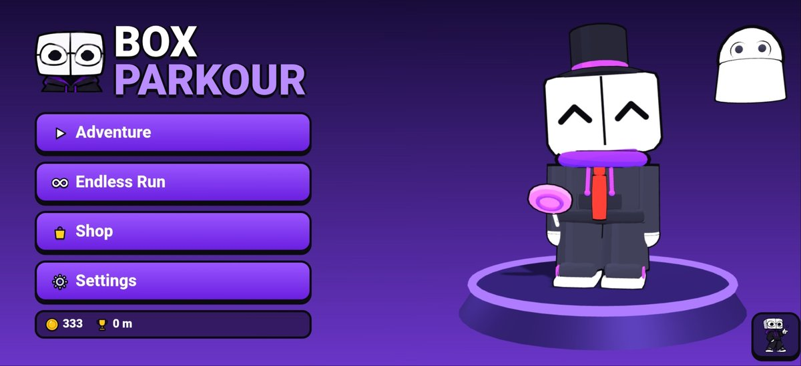
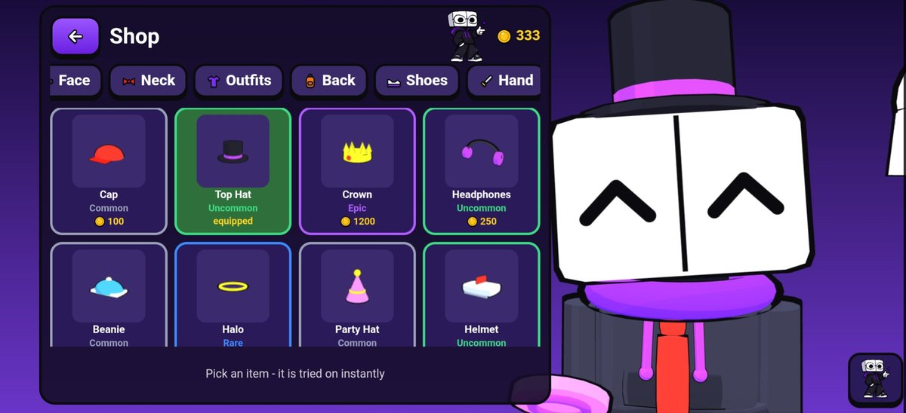
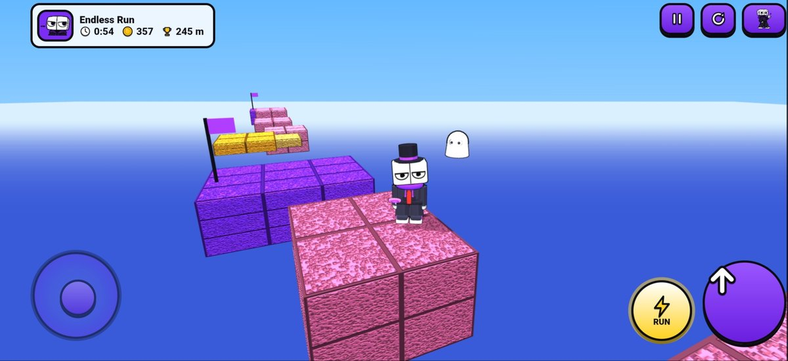

# BOX PARKOUR

**A fast 3D parkour game that runs right in your browser.**
Jump across floating platforms, collect coins, dress up your box.

[English](#english) · [Русский](#русский)

 

  
  
  

---

## English

### About

Box Parkour is a 3D platformer built as a single HTML file — no install, no build step. Open the page and run. It works on phones (touch controls) and on desktop (keyboard).

### Features

- 🏃 **Adventure** — hand-made parkour levels with checkpoints
- ♾️ **Endless Run** — keep going and beat your distance record
- 🛍️ **Shop** — hats, face, neck, outfits, back, shoes and hand items in Common / Uncommon / Rare / Epic rarities, tried on instantly
- 🪙 **Coins** — collect them while you run and spend them on cosmetics
- 😀 **Emotes** and a little ghost buddy that follows you
- 💾 **Auto-save** — coins, items and records are stored in your browser
- 📱 **Mobile-first** — on-screen joystick, jump and run buttons

### Controls

| Action | Desktop | Mobile |
|---|---|---|
| Move | `W` `A` `S` `D` / arrows | left joystick |
| Jump | `Space` | jump button |
| Run | `Shift` | **RUN** button |
| Emote | `E` | character button |
| Respawn | `R` | restart button |
| Menu | `Esc` | pause button |

### Play

Open **https://dipodev20.github.io/box-parkour/**

Or run it locally — just open `index.html` in a browser.

> The game loads Three.js from a CDN, so an internet connection is needed on first launch.

### Tech

- Vanilla JavaScript, one `index.html`
- [Three.js](https://threejs.org/) r128 (WebGL)
- `localStorage` for saves
- Hosted on GitHub Pages

### License

Released under the [MIT License](LICENSE) · © 2026 [dipodev20](https://github.com/dipodev20)

---

## Русский

### Об игре

Box Parkour — 3D-платформер в одном HTML-файле: без установки и сборки. Открыл страницу и бежишь. Работает на телефоне (сенсорное управление) и на компьютере (клавиатура).

### Возможности

- 🏃 **Adventure** — паркур-уровни с чекпоинтами
- ♾️ **Endless Run** — беги дальше и побей свой рекорд дистанции
- 🛍️ **Магазин** — шляпы, лицо, шея, наряды, спина, обувь и предметы в руку, редкости от Common до Epic, примерка сразу на персонаже
- 🪙 **Монеты** — собирай по пути и трать на косметику
- 😀 **Эмоции** и маленький призрак-компаньон
- 💾 **Автосохранение** — монеты, предметы и рекорды хранятся в браузере
- 📱 **Для телефона** — экранный джойстик, кнопки прыжка и бега

### Управление

| Действие | ПК | Телефон |
|---|---|---|
| Движение | `W` `A` `S` `D` / стрелки | левый джойстик |
| Прыжок | `Space` | кнопка прыжка |
| Бег | `Shift` | кнопка **RUN** |
| Эмоция | `E` | кнопка персонажа |
| Возрождение | `R` | кнопка перезапуска |
| Меню | `Esc` | кнопка паузы |

### Играть

Открой **https://dipodev20.github.io/box-parkour/**

Или запусти локально: просто открой `index.html` в браузере.

> Three.js подключается с CDN, поэтому при первом запуске нужен интернет.

### Лицензия

Распространяется по лицензии [MIT](LICENSE) · © 2026 [dipodev20](https://github.com/dipodev20)
